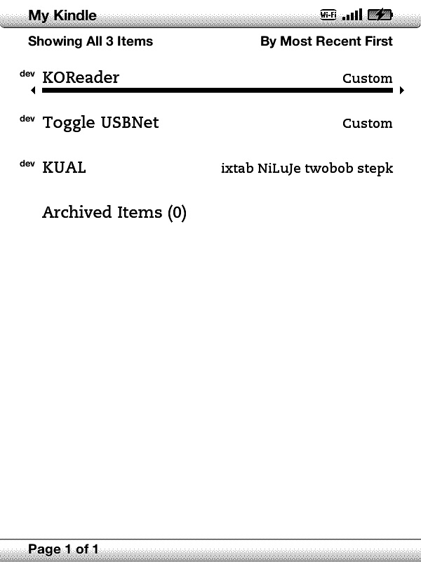

# Kindle 4 Kindlet Launcher

A lightweight tool to generate signed, standalone Kindlet book launchers (`.azw2`) for **Amazon Kindle 4 (Non-Touch / Black / Silver)** and other KDK 1.0 devices.

Launch readers (**KOReader**), tools (**USBNetwork**), or custom shell scripts directly from the Kindle Home screen with a single click.

> <sub>**Author's Note:** This project was developed entirely with AI assistance. I had the idea and the need for a working standalone launcher for the Kindle 4 Non-Touch, but lacked the programming skills to build the bytecode patching and cryptographic signing myself. Sharing this in hopes that it helps others in the community!</sub>

<p align="center">
  
</p>

---

## Features

- **Pure Python:** Runs on Windows, macOS, and Linux with Python 3. No Java SDK or build tools required.
- **Signed & Ready:** Automatically signs packages using MobileRead developer keys (`DNTEST`, `DITEST`, `DKTEST`) so they run without errors on jailbroken devices.
- **Background Execution:** Launches commands cleanly in the background and hands over control seamlessly.
- **Ready-to-Use Examples:** Includes pre-built `.azw2` files for **KOReader** and **USBNetwork toggle** — no Python required if you just need these two.
- **Wireless Deployment:** Optional `--upload <IP>` flag deploys directly to your Kindle over Wi-Fi via SSH.

---

## Pre-built Launchers Included

If you don't need custom commands and just want working launchers right away, this repository already includes two pre-built `.azw2` files:

1. **[`KOReader.azw2`](KOReader.azw2)** — Launches KOReader directly from the Home screen with a single click.
2. **[`Toggle_USBNet.azw2`](Toggle_USBNet.azw2)** — Toggles between USBNetwork (SSH) and USBMS (USB Drive) modes.

Simply copy either `.azw2` file directly to your Kindle's `/documents/` folder over USB or SSH!

---

## Installation

Install required Python dependencies (only needed if building custom launchers):

```bash
pip install cryptography pyasn1 pyasn1-modules paramiko
```

> **Requirement:** Your Kindle must be **jailbroken** with the **MobileRead Kindlet Kit (MKK)** installed.

---

## Usage

### Building Custom Launchers

#### 1. KOReader Launcher
```bash
python make_launcher.py \
    --name "KOReader" \
    --cmd "[ -f /mnt/us/koreader/koreader.sh ] && /mnt/us/koreader/koreader.sh || /mnt/us/extensions/koreader/bin/koreader.sh" \
    --output "KOReader.azw2"
```

#### 2. USBNetwork Switcher (toggle USBNet / USBMS)
```bash
python make_launcher.py \
    --name "Toggle USBNet" \
    --cmd "/mnt/us/extensions/usbnet/bin/usbnet.sh toggle_usbnet" \
    --dir "/mnt/us/extensions/usbnet" \
    --title "USBNetwork" \
    --output "Toggle_USBNet.azw2"
```

---

### Wireless Deployment (Wi-Fi / SSH)

To deploy directly to your Kindle without connecting a USB cable, specify `--upload <Kindle-IP>`:

> **Kindle SSH Credentials:**
> - The SSH username is always **`root`**.
> - The root password is generated from your Kindle serial number (found in *Settings -> Device Info*). Calculate your password at: **[https://www.sven.de/kindle/](https://www.sven.de/kindle/)**

```bash
python make_launcher.py \
    --name "KOReader" \
    --cmd "/mnt/us/koreader/koreader.sh" \
    --upload 192.168.1.23 \
    --ssh-pass "YOUR_PASSWORD"
```

*(If `--ssh-pass` is omitted, the script will prompt you to enter it).*

Uploaded `.azw2` files are automatically placed in `/mnt/us/documents/`.

---

## CLI Options

| Argument | Default | Description |
| :--- | :--- | :--- |
| **`-n`**, **`--name`** | *Required* | Name displayed in the Kindle Library |
| **`-c`**, **`--cmd`** | *Required* | Shell command or script path to run |
| **`-d`**, **`--dir`** | `/mnt/us` | Working directory for the command |
| **`-v`**, **`--vendor`** | `Custom` | Author / vendor name under the book title |
| **`-o`**, **`--output`** | `<name>.azw2` | Output filename |
| **`--title`** | `<name> Launcher` | Header text shown on launcher screen |
| **`--timeout-msg`** | *Default note* | Instruction text if command takes >10s |
| **`--exit-msg`** | *Default note* | Instruction text shown on exit |
| **`--config`** | *None* | Path to a JSON configuration file |
| **`--upload`** | *None* | Kindle IP address to upload via SSH |
| **`--ssh-pass`** | *Prompt* | Kindle root password ([calculator](https://www.sven.de/kindle/)) |

---

## Configuration via JSON

You can also store settings in a `config.json` file:

```json
{
  "name": "KOReader",
  "command": "/mnt/us/koreader/koreader.sh",
  "workdir": "/mnt/us",
  "vendor": "KOReader Team",
  "title": "KOReader Launcher",
  "timeout_msg": "If you see this screen > 10s: press [BACK] to exit.",
  "exit_msg": "On KOReader exit: press [BACK] twice if frozen.",
  "output": "KOReader.azw2"
}
```

Run with:
```bash
python make_launcher.py --config config.json
```

---

## Refreshing the Library

When copying `.azw2` files over Wi-Fi/SSH, refresh the Kindle Home screen to make new books appear:

- **On device:** `Menu` -> `Settings` -> `Menu` -> `Restart`.
- **Or via KUAL:** `KUAL` -> `Helper+` -> `Restart Framework`.
- **Or via SSH:**
  ```bash
  /etc/init.d/framework restart
  ```

